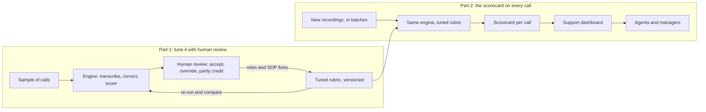

# Scoring every support call against our own playbook

> **TL;DR:** We could manually review only a small sample of our phone support calls, and the commercial call-scoring tools grade against a generic rubric. I built this in two parts. First, a pipeline that transcribes a call and scores it against our own SOPs, tuned through three rounds of human review until I trusted the scores. Second, what that tuning earned: a scorecard on every call, sitting in the support dashboard where agents and managers could see it. Most of what the reviewers caught turned out to be problems in our procedures, not in the model.

A sanitized case study of a tool I designed and built at ScanPay, a payments company for the trades, where I was Head of Product and ran merchant support. It is the reasoning and the design, not the code. It is one of five builds in the [support-ops AI stack](https://github.com/mananritwik/support-ai-stack).

## The problem

Support agents took inbound and outbound calls, and every call was recorded. The review process was a one-page PDF rubric that a manager filled in after listening to a call. In practice we could manually review only a small sample, which made it hard to say how phone support was doing overall.

The obvious fix was to buy a conversation-intelligence tool. I looked at what a tool like Gong does, and it is a strong product. But it prices per seat, so the bill climbs with every hire, and it scores against a generic rubric. The thing I most wanted to know was whether an agent followed our procedures, and no vendor has those. Our SOP set is the one asset a vendor cannot sell us.

## The shape of it: two parts

**Part 1 is the tuning.** I ran the engine on a sample of calls, had human reviewers correct it, and turned every disagreement into a rule or a fix to our SOPs. That produced a versioned rubric I could trust.

**Part 2 is the scorecard.** The tuned rubric then scored calls going forward, and each call's scorecard appeared in the support dashboard, where agents and managers saw it.

## The engine

Four automated stages, each doing a single job. The pipeline is built to score every recorded call; I built and tuned it on a sample.

1. **Fetch.** Pull each recorded call and its metadata (agent, direction, contact).
2. **Transcribe and separate speakers.** An open-source transcription model on my own machine's GPU, so transcription cost nothing.
3. **Correct.** A small model fixes accent-related errors using what the call metadata already knows, such as the agent's and the customer's names.
4. **Score.** A larger model rates five dimensions (resolution, customer experience, communication, efficiency, process adherence), raises flags with a severity and one of twelve fixed categories, writes coaching notes and lists action items. It reads our whole SOP set, about sixty thousand tokens, from a prompt-cached block, so the knowledge is present on every call but paid for once.

End to end the cost was about seven cents a call, against the twelve to eighteen thousand dollars a year that tools like Gong cost at our team size, and it does not rise with headcount.

## Part 1: Tuning it with human review

The engine scored fast. The question was whether to believe it. The answer was a review tool and a fixed way of working with it.

**The review tool.** A small web tool where several reviewers accept, override or partly credit each judgment. Every reviewer's verdict is stored separately and never auto-deleted, with agreement shown between them. Reviewers see the calls most likely to need attention first, using a priority score. When the speaker separation is low-confidence, the call is flagged and the reviewer can play the audio, not just read the transcript. People outside the support team reviewed through an authenticated link, with no VPN or server login. Together the verdicts form the gold set that every rubric change is checked against.

**How a rubric change is made.** Write the rule, bump the version, re-run the gold set (I re-ran all 52 calls twice), compare with the human verdicts, then keep it or revert it. Every scorecard carries its rubric version, and trend reports never compare scores across versions. A number from one version of the rubric is not the same number from another.

### The decisions that shaped it

- **Build the scoring, own the rubric.** The whole value was grading process adherence against our SOPs, so that was the part to own. The honest caveat I keep attached: a dedicated vendor could well score deeper. The way to find out is to keep checking my baseline against human reviewers, not to assume that building wins.
- **Rules and a rubric over a black box.** Every flag and score traces back to a rubric rule. When reviewers disagreed with the model, I changed an explicit instruction, not the model. That keeps the tool auditable, and a reviewer can see why a flag fired.
- **Whole knowledge base in the prompt, no retrieval layer.** At our size, caching the full SOP set beat the complexity of retrieval. It only works if calls are scored in batches, so the cache is written once and read many times.
- **Identify the agent from what is said, not who speaks first.** Assuming the first speaker is the agent is wrong on outbound calls, where the customer answers the phone. I switched to content-based identification and re-ran the first 52 calls. Nearly half of them (24 of 52) had the roles reversed, which had corrupted about half of the original scorecards.
- **Human review is calibration, not just QA.** A reviewer's "wrong" vote is the main signal for improving the rubric. The system is built to learn from human judgment, not replace it.

### How I know the scores can be trusted

- **Three rounds of human review.** Reviewers marked each AI flag correct, partial or wrong, and accepted or overrode each score. The third round had four reviewers and 62 reviews on 32 calls. Each round produced explicit "do not flag this" rules written into the scoring instructions.
- **Agreement within one point of the humans on every dimension, 93 to 98 percent of the time.** Weakest on process adherence, because the model was too harsh there. Its harshness gap against human reviewers roughly halved after the third round.
- **A caveat I would raise before anyone else does.** Reviewers saw the AI's score while rating, so exact-match agreement is anchored and I do not trust it. Within-one agreement and the direction of the bias are the honest numbers. A few judgments the model made again even after I wrote a rule against them, which I would fix with worked examples instead of more rules.
- **A transcription test.** On a 14-call set I compared a small model with a domain vocabulary against a larger one. The small model captured about 85 to 90 percent of the gain in domain-term accuracy and ran about three times faster, so I chose it.

All of this comes from the sample I used to build and tune it: 52 calls, plus a 14-call test set for transcription. The pattern is solid. The sample is small.

### What the reviewers taught me

The numbers above are the least interesting part. These are what the reviewers actually taught me.

> **A grader that keeps misfiring is usually pointing at a blunt procedure.** Fix the procedure and the grader inherits the fix.

**Identity checks scale with risk.** The model kept flagging missing identity verification, and it was the biggest coaching theme. But most of those calls were outbound, to the number already registered on the account, and our rule had been written for inbound calls only. It demanded the same full check for every call. I rewrote the procedure into tiers: a light check for general questions, more for account specifics, and the full check for anything that moves money or changes account details. The grader read the corrected SOP and the false flags went away. I fixed the playbook, not the prompt.

**Judge escalation by what it would change, not by urgent-sounding words.** The model flagged "urgent escalation not handled" on a call where the case was already with the right team. Escalating again would not have changed what the customer received. The real failure was a vague stall. So the rubric now asks whether escalating would change what the customer gets, or how fast, and it separates three cases: escalating would unblock something, the situation requires notifying someone regardless, and escalating would add nothing. The non-negotiable is that the customer leaves with an answer, or a commitment with a who, a what and a by-when.

**Only flag what the transcript can show.** Flags like "no lookup was performed in the internal tool" assert the absence of silent work the transcript cannot reveal. I removed that whole class. I also stopped scoring transcription glitches and abrupt disconnects as agent behavior.

**The grader found a procedure we had never written.** On escalation calls our knowledge base gave turnaround times for most request types but not for one kind of review. With no honest number to give, agents stalled, and the evaluator kept flagging the stall. The QA loop surfaced the gap, and the fix was to document the real turnaround. A call-QA tool grades agents, and it also shows where the operating procedure is missing.

**Coaching suggestions have to be complete.** The model's suggested phrasing once gave the reassurance line and left out a second point that the SOP entry contained. A grader can be grounded in the knowledge base and still under-coach, so the rule is that a suggestion must reflect the whole entry.

**The vocabulary prompt leaked into the transcripts.** During a hold, the transcription hallucinated a sentence about the company name four times. It came word for word from my own prompt, which I had written as a sentence. The cure was to write the vocabulary as a bare list of terms, with nothing to echo, plus a filter that drops repeated sentences. The thing meant to improve recognition was corrupting the output. Vocabulary mattered more than model size here. On the test set, the company name was recognized once with no vocabulary, 34 times with the vocabulary, and 41 times with the vocabulary and a larger model.

## Part 2: The scorecard on every call

This is the part agents and managers actually used. Part 1 was the work; this is what it produced.

**What a scorecard holds.**
- Scores on the five dimensions.
- Flags, each with a severity (red, yellow or green) and one of the twelve categories, tied to the SOP entry the call was judged against.
- Coaching notes that point to the real policy, with suggested phrasing.
- The customer's sentiment.
- A list of action items.

**Where it showed up.** The scorecards fed the same support dashboard as tickets and messages. Call quality appeared in the per-agent, per-merchant and monthly views next to everything else, and agents, who also had access to the dashboard, could see the scorecards. Because the flags use fixed categories, you could see which flags fire most, and which agents score lowest on which dimension, a pattern a person spot-checking calls would miss.

**How it ran.** I ran new batches ahead of the weekly review meeting, always in batches so the SOP set is written to the prompt cache once and read for every call after it; without the cache, a batch costs two to three times more. Each new call was scored with the tuned rubric version, stamped on its scorecard. I ran it from my own machine while the move to our engineering team's AWS GPU resources, so transcription could run at scale, was planned.

## What it can't do

The method carried into the other builds in the stack. Stated plainly, because a case study that lists only wins is not worth reading:

- **No automated tests for the pipeline itself.** The human review loop is the safety net, and it is not a substitute.
- **Anchored agreement.** See above. A blind first pass, where reviewers rate before they see the AI score, is the fix I would try.
- **Short calls and one-sided calls fool the speaker separation.** Under about thirty seconds, where one person barely speaks, it fails. I flag those for a human and have no algorithmic fix.
- **Dollar amounts in transcripts are unreliable.** Phone audio is narrowband, so "seven forty-five" and "seven hundred forty-five" can be indistinguishable. That is a limit of the audio, not something prompting fixes.
- **Call-pattern anomaly explanations are roadmap, not shipped.**

The code is private. I am happy to walk through it in a conversation.

## What this transfers

The specific tool scored phone calls, but the judgment is portable. If you grade AI output against your own standard, expect the first round of disagreement to expose your standard. Version the rubric, keep a human in the loop to calibrate, report the agreement numbers that survive scrutiny, and fix the procedure before you fix the prompt. That holds for any AI feature that has to be right more than it has to be fast.

---

Built by Ritwik Manan. More at [github.com/mananritwik](https://github.com/mananritwik).
